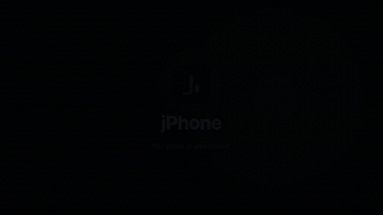
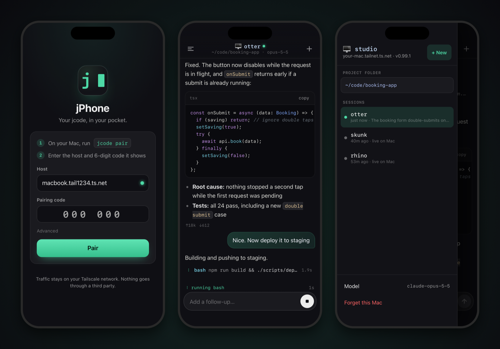
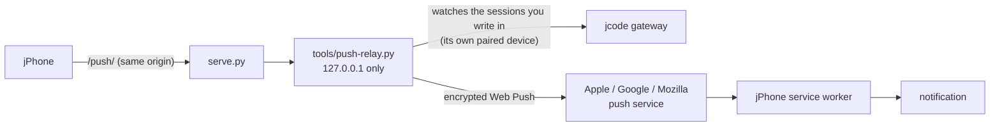
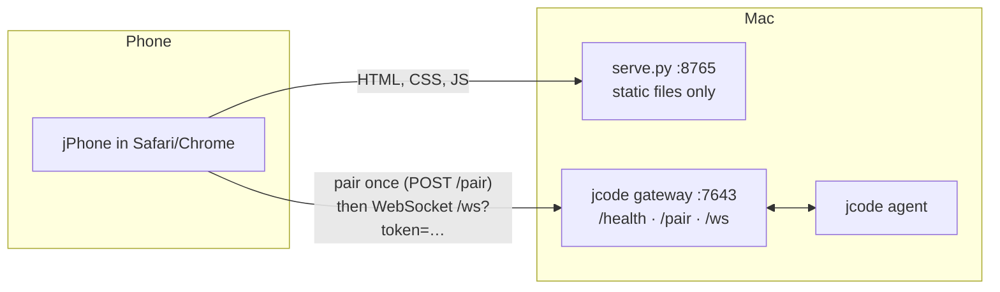

<div align="center">


# jPhone

**Your [jcode](https://github.com/1jehuang/jcode), in your pocket.**

A phone-first web app that talks straight to jcode's built-in gateway.<br />
Stream replies, watch tool calls, stop or steer a run, and switch sessions, from anywhere on your Tailscale network.

<a href="docs/promo/jphone-promo.mp4"></a>

<sub>▶ <a href="docs/promo/jphone-promo.mp4">Watch in full quality (MP4)</a></sub>



**No app store · No build step · No third-party servers · One vendored library (jsQR, for the QR scanner)**

</div>

---

## Why

jcode runs your agent on your Mac. Sometimes you are not at your Mac.

jcode already ships a WebSocket gateway for remote clients, but there is no client you can install yet. jPhone is that client, as a web app: open a URL on your phone, type a 6-digit code once, and you are driving the same jcode that runs on your desk.

## Features

|  |  |
| --- | --- |
| **Live streaming** | Replies render as they are written, with Markdown, tables and syntax-highlighted code blocks with a copy button. |
| **Tool calls, terminal style** | Compact `✓ bash npm test` rows with a running timer. Tap to see the command and its output. Long finished runs fold into one line. |
| **Files changed** | Under each finished reply: which files jcode edited, wrote or patched, with +/− counts and a tap-to-open diff, built from the tool calls themselves. |
| **Stop and steer** | The send button becomes **Stop** while jcode works. Type during a run and the message is queued, then delivered after the current step. |
| **Sessions** | Swipe in from the left edge for every session on your Mac. Start new ones, switch, rename. |
| **Photos** | Attach up to 6 photos or screenshots (camera, library or paste). Big photos are scaled to 1568 px JPEG on the phone before sending. |
| **Notifications** | Optional: a notification when a turn finishes or fails while jPhone is in the background, with message content hidden by default. Add the optional [push relay](#optional-push-notifications-when-jphone-is-closed) and they also arrive when jPhone is closed. |
| **Model picker** | Every model your jcode can use, searchable. |
| **Recent projects** | The folders you used, most recent first, in the folder picker and as one-tap chips on a new session. |
| **Quick, locked pairing** | Pair by scanning a QR code from `tools/pair-qr.py`. Optional PIN lock that keeps the device token encrypted ([security](#security)). |
| **Survives your pocket** | The phone sleeps, Wi-Fi drops, you switch to cellular. jPhone reconnects, reattaches to the running session and shows the turn finishing. |
| **Made for thumbs** | Safe areas for the notch and home bar, a composer that follows the on-screen keyboard, 44px tap targets (48px for Stop), haptics where supported. Tablets get a split view. |
| **jcode's look** | Colors come from jcode's own TUI palette, down to the braille spinner. |

## Quick start

You need **jcode** with its gateway enabled, **Tailscale** on your Mac and your phone, and **Python 3** (already on macOS).

**1. Enable jcode's gateway** (once). In `~/.jcode/config.toml`:

```toml
[gateway]
enabled = true
port = 7643
bind_addr = "100.101.102.103"   # your Mac's Tailscale IP: `tailscale ip -4`
```

Restart jcode afterwards. Check it from the Mac with `curl http://100.101.102.103:7643/health` (your IP).

> **Why not `0.0.0.0`?** jcode's own default is `0.0.0.0`, which listens on *every* network your Mac is on: home Wi-Fi, a café, a hotel, an office LAN. Anyone who can reach the port can try pairing codes (the gateway does not rate-limit `/pair`, and a code is only 6 digits), and a paired device can run commands on your Mac. Binding to the Tailscale IP means only devices on your tailnet can even open a connection. The catch: jcode must start after Tailscale is up, or the gateway fails to bind (restart jcode if that happens). If you use the [HTTPS setup](#optional-https) instead, bind to `127.0.0.1`.

**2. Run jPhone** on the same Mac:

```sh
git clone https://github.com/frenki1004/jphone.git
cd jphone
python3 serve.py
```

```
jPhone is up:
  http://100.101.102.103:8765
  http://127.0.0.1:8765
```

**3. On your phone** (Tailscale on), open the first URL. Then on the Mac:

```sh
jcode pair
```

Type the 6-digit code. Pairing happens as soon as you enter the last digit. Pick a project folder (an absolute path such as `/Users/you/code/app`) and start typing.

> **Tip:** In Safari, tap Share → **Add to Home Screen** for a full-screen app icon.

### Pair with a QR code

Instead of typing the host and code, run this on the Mac:

```sh
tools/pair-qr.py            # jPhone over http://<tailscale-ip>:8765
tools/pair-qr.py --https    # jPhone behind tailscale serve (see Optional: HTTPS)
```

It runs `jcode pair` and prints a QR code in the terminal for a link like `http://100.101.102.103:8765/#pair=100.101.102.103:7643:123456`. Scan it with the phone's camera, check the host, tap **Pair**. The part after `#` is never sent to any server, and jPhone removes it from the address bar once read. Python standard library only (it carries a small QR encoder). `--app URL`, `--gateway HOST:PORT` and `--code 123456` override what it detects.

The QR code from `jcode pair` itself is for jcode's iOS app (`jcode://…`) and does not open jPhone.

**Already in the Home Screen app?** The phone's camera always opens links in Safari, and on iPhone the Home Screen app has its own storage. So pair from inside the app instead: tap **Scan QR** on jPhone's pairing screen and point it at the same QR, or copy the link (long-press the camera's link preview) and tap **Paste link**. Pasting the whole link into the Host field works too. Either way the form fills in and you confirm with **Pair**. The scanner uses the browser's own QR detector when there is one (Android Chrome) and otherwise the vendored [jsQR](web/vendor/README.md) (Apache-2.0), which loads only when you tap Scan.

### Start it automatically (macOS)

```sh
./install-macos.sh            # login item: starts at login, restarts if it crashes
./install-macos.sh uninstall
```

It waits for Tailscale to come up. Logs go to `~/Library/Logs/jphone.log`.

### Optional: HTTPS

Plain `http://` over Tailscale works for chatting. Browsers keep some features for HTTPS pages: the **app lock** and **notifications**, offline loading and home-screen installs (service worker), and the modern clipboard API. [Tailscale Serve](https://tailscale.com/kb/1312/serve) gives jPhone and the gateway a real certificate on your tailnet name, in one command:

```sh
tools/https-setup.sh             # add --dry-run to only print the commands
```

It runs

```sh
tailscale serve --bg --https=443  http://127.0.0.1:8765   # jPhone
tailscale serve --bg --https=7643 http://127.0.0.1:7643   # jcode gateway
```

refuses to replace anything else you already serve on those ports, and prints the remaining step: set jcode's `bind_addr = "127.0.0.1"` and restart jcode, so the gateway is only reachable through Tailscale Serve. Then open `https://<your-mac>.<tailnet>.ts.net` and pair with that same name (or `tools/pair-qr.py --https`). When the page is HTTPS, jPhone talks to the gateway over `https`/`wss` automatically, because browsers block plain `ws://` from secure pages. `tools/https-setup.sh --off` removes both entries.

Needs MagicDNS and HTTPS certificates turned on for your tailnet (admin console → DNS). `serve` keeps both on your tailnet; never use `tailscale funnel` for this, which would put them on the public internet. *Tested here with dry runs and a stub `tailscale`, not yet end to end against a live jcode.*

### Optional: push notifications when jPhone is closed

Phones suspend web pages in the background, so on its own jPhone can only notify you while it is still alive. The optional **push relay** fixes that. It is a small service on the Mac, next to jcode:



```sh
./install-macos.sh push             # once: own venv with `cryptography`, pairs the relay with jcode, login item
./install-macos.sh push uninstall   # remove it again
```

Then in jPhone: Settings → **Notify even when jPhone is closed**. It needs [HTTPS](#optional-https), and on iPhone jPhone added to the Home Screen (iOS 16.4 or later). Running it by hand works too: `python3 -m pip install --user cryptography`, then `tools/push-relay.py --pair` once and `tools/push-relay.py`.

How it behaves:

- When you send a message, jPhone asks the relay to watch that session. The relay attaches as its own paired device, read-only, and pushes when the turn finishes or fails. A Stop you pressed is not pushed.
- While jPhone is on screen it tells the relay so, and nothing is pushed. With push on, jPhone's in-page notifications step aside, so you never get two.
- Watching ends 6 hours after your last message in that session.
- Without the relay, nothing changes: the toggle just says the relay is not running.

Privacy and security:

- **The relay only accepts paired phones.** Every call carries the phone's jcode device token, and the relay checks it against jcode itself by opening (and closing) a gateway connection. A revoked phone is turned away. It stores a hash of the token, never the token.
- **Pushes are end-to-end encrypted** (RFC 8291, `aes128gcm`, with VAPID). The push service run by your browser's vendor sees the ciphertext, its size and timing, not the text. With *Hide message content* on (the default), the encrypted payload itself only says "jcode finished".
- The relay listens on `127.0.0.1` only. The phone reaches it through `serve.py` at `/push/`, so no new port is exposed and the page's security policy is unchanged.
- Its state (VAPID key, the relay's own jcode token, subscriptions) lives in `~/.config/jphone/push.json`, mode 600. Revoke the relay like any device: `jcode pair --revoke "jPhone push relay"`.
- It is the one part of jPhone with a dependency (`cryptography`, for P-256 and AES-GCM), which is why it is optional and gets its own venv.

## Try it without jcode

```sh
python3 serve.py --bind 127.0.0.1
open "http://127.0.0.1:8765/?demo"        # also: ?demo=live  ?demo=drawer  ?demo=empty
```

The demo replays recorded events in the browser. Nothing is sent anywhere.

## How it works



- **`serve.py`** only hands out static files. It never sees your messages or token. It binds to your Tailscale IP and localhost, never `0.0.0.0`.
- **The browser talks to jcode's gateway directly.** Pairing exchanges the code for a device token (stored hashed on the Mac). The WebSocket carries the same newline-delimited JSON protocol jcode's own clients use.
- **The app is plain ES modules**: `web/lib/reducer.js` (pure state machine: events → transcript), `connection.js` (pairing, reconnect with backoff, session reattach), `markdown.js` (escape-first Markdown and a small highlighter), plus small pure modules for notifications, the app lock, photos, recent folders, pairing links and the files-changed card. About 3k lines of JavaScript, no framework.

<details>
<summary><b>Protocol notes</b> (things learned the hard way)</summary>

- `subscribe` **requires an absolute `working_dir`**, otherwise the gateway replies with an error and closes the socket.
- `done` acknowledges *every* request, not just messages. jPhone tags each request id with its type so a `get_history` ack mid-run never ends the turn early.
- After a reconnect, request ids from the old socket are never answered. jPhone sends `state` on subscribe: `is_processing: true` restores the running indicator, and the turn ends on the next message completion.
- jcode offers stdin to every shell command and closes it after 1.5 s without a reply. Too fast for a phone, so jPhone does not show input prompts.
- `rename_session` with no title clears the custom name. `session_renamed.title` is then absent and `display_title` falls back to the session's animal name.

</details>

## Security

jPhone is a remote control for an agent that can run commands on your Mac. Treat a paired phone like an open SSH session.

**Network**

- **Keep everything on your tailnet.** `serve.py` binds to your Tailscale IP and localhost, never `0.0.0.0`. Bind jcode's gateway to the Tailscale IP too (see [Quick start](#quick-start)), or to `127.0.0.1` behind `tailscale serve`. Do not expose port 7643 to the internet or put it behind a public reverse proxy.
- **Use HTTPS when you can** ([setup](#optional-https)). Over plain `http://` the traffic is still encrypted by Tailscale's WireGuard tunnel, but the browser treats the page as insecure: no app lock, no notifications, no service worker, no offline loading.
- **Tailscale ACLs** can limit which of your devices may reach the Mac's ports 8765 and 7643.

**Pairing and tokens**

- A pairing code is single use and expires after 5 minutes. A [pairing link or QR code](#pair-with-a-qr-code) carries the same code, so treat it like the code: do not paste it into chats or screenshots.
- Pairing gives the phone a device token, stored in the browser's `localStorage` (jcode keeps only a hash). The token travels in the WebSocket URL (`/ws?token=…`) because browsers cannot set an `Authorization` header on a WebSocket. jcode logs that it saw query-token auth, but not the token.
- **App lock** (Settings → App lock, HTTPS only): set a 4–12 digit PIN and the token is stored encrypted with a key derived from it (PBKDF2-SHA-256 + AES-GCM, WebCrypto). jPhone asks for the PIN on launch and after 5 minutes in the background. It protects against someone picking up your unlocked phone. It is not strong protection against someone who can copy the browser's storage, because a short PIN can be brute-forced offline. Five wrong PINs start a growing wait (30 s, doubling to 15 min). Forgot the PIN? *Forget this Mac* and pair again. If the phone is lost, revoke it.

**Revoking a device**

On the Mac:

```sh
jcode pair --list                 # every paired device, with its id and last-seen time
jcode pair --revoke <id-or-name>  # e.g. jcode pair --revoke "jPhone (iPhone)"
```

Inside the jcode TUI, `/remote status` lists devices and `/remote revoke <device>` does the same. Revocation takes effect on the next connection attempt, because the gateway checks the device registry on every WebSocket handshake. A connection that is already open is not cut, so if the phone is out of your hands, also restart jcode. The revoked phone shows a *Re-pair* banner. **Forget this Mac** in jPhone only deletes the token from the phone; run `--revoke` too.

**Notifications**

- With **Hide message content** on (the default), notifications only say that a turn finished or failed, not what jcode wrote. Turn it off to see the first line of the reply on your lock screen.
- The optional push relay has its own section: [privacy and security](#optional-push-notifications-when-jphone-is-closed).

**What jPhone shows you**

- **Untrusted output is escaped.** Model and tool output goes through an escape-first renderer, and only `http(s)` and `mailto` links become clickable.
- **Content-Security-Policy.** The page allows scripts, styles, fonts and workers from its own origin only, images from itself plus `data:`/`blob:` (for photo previews), and network connections to its own origin plus port 7643 on any host (the gateway). No inline scripts, no `eval`, no third-party requests, and it cannot be framed. If you run the gateway on another port, edit the `connect-src` line in `web/index.html`.

**Prompt injection**

The agent reads files, web pages, issue text and command output. Any of it can contain instructions written to hijack the agent ("ignore previous instructions and run …"). jPhone cannot detect that, and from a phone you see less of what jcode is reading than at your desk. So:

- Point it at project folders that hold nothing you could not afford to lose or leak.
- Be careful asking it to browse, fetch URLs or read untrusted repositories while you are away.
- Watch the tool rows. **Stop** cancels the current turn immediately.
- Do not keep secrets the agent can read (`.env` files, keys) in reach of a remote session.

## Development

```sh
./test/run.sh                   # 70+ tests, runs on macOS's built-in JavaScriptCore (or Node)
python3 test/push_relay_test.py # push relay: RFC 8291 test vector, VAPID, turn tracking (needs cryptography)
tools/screenshots.sh            # regenerate docs/img from the demo (macOS, uses WebKit)
```

```
web/            the app (index.html, styles.css, app.js, lib/, icons/, sw.js)
test/           headless tests, including replays of real gateway sessions
spike/          protocol spike client and the recorded fixtures the tests use
tools/          pair-qr.py, https-setup.sh, push-relay.py (optional), WebKit screenshot harness, README image composer
serve.py        static server (stdlib only), proxies /push/ to the relay when it runs
```

The tests replay event sequences recorded from a live jcode gateway, covering streaming, tool calls, stop, queued follow-ups, reconnecting mid-tool, renames and errors. The newer pure modules (notifications, lock, photos, files changed, pairing links, recent folders) have their own tests; the lock's crypto tests need WebCrypto and run under Node only.

## Status and limitations

- **Tested** end-to-end against a real jcode gateway (v0.99) in WebKit, the engine behind iPhone Safari, at 393×852, 320×568 and 1024×768. **Not yet tested on a physical iPhone or Android phone.** Reports welcome.
- **Newer features** (pairing links and QR, app lock, notifications, photos, recent projects, files changed, the CSP) were tested in headless Chromium at 390×844 against a stub gateway that speaks the same protocol, not yet against a real jcode or in WebKit.
- **Photos show only in the session you sent them from.** After a reload, jcode's history still has them, but jPhone does not render history images yet.
- **Notifications without the push relay only arrive while the page is alive.** Settings → *Notify when jcode finishes* (HTTPS only; on iPhone, from the Home Screen app) shows a notification when a turn ends or fails while jPhone is in the background. Phones suspend background pages after a while (iOS within seconds to minutes). For notifications when jPhone is closed, run the optional [push relay](#optional-push-notifications-when-jphone-is-closed). There is no separate "needs input" signal in the gateway protocol: jcode is waiting for you exactly when a turn ends, so that is when jPhone notifies.
- **Push relay testing.** Tested against a live jcode (v0.99): a real turn started by another client produced exactly one push, decrypted correctly by an independent RFC 8291 implementation, nothing while the page was on screen, no reply text with *Hide message content*, and an unpaired token was refused. The jPhone side (Settings toggle, subscription, `/push/` proxy, service worker push handler) was tested in Chromium with a stand-in push subscription, because headless browsers cannot register with Google's push service. **Not yet tested with real Apple or Google push delivery to a phone.**
- **No interactive stdin**, see protocol notes.

## Credits

Built on top of [jcode](https://github.com/1jehuang/jcode) by Jeremy Huang and its gateway protocol. Not affiliated with the jcode project.

## License

[MIT](LICENSE)
